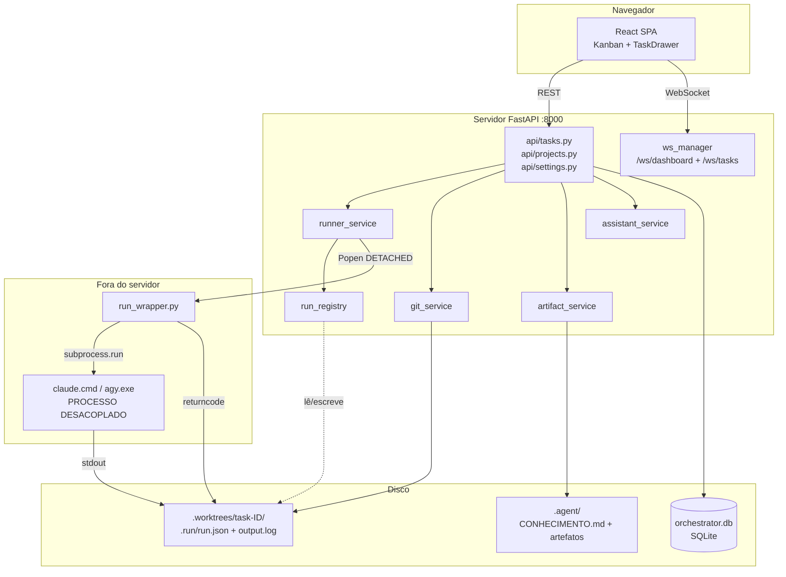
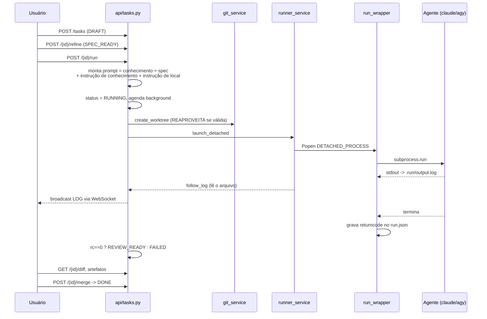

# Mapa do Codebase

> Gerado pelo Cartographer. Último mapeamento: 2026-10-13.
> Descreve o código como ele estava nesta data. Em caso de divergência, o código manda.

## O que este projeto é

Um orquestrador local de agentes de IA. O usuário descreve uma tarefa, escolhe um motor
(Claude Code CLI ou `agy`/Antigravity CLI), e o orquestrador despacha o agente **dentro de
um git worktree isolado** daquele projeto. O trabalho aparece num painel kanban, e o usuário
revisa o diff antes de aprovar o merge.

Os cinco problemas que o projeto ataca (das specs em `docs/specs/`):

1. **Colisão de canais** — um chat linear mistura respostas de vários agentes → canal e histórico por tarefa.
2. **Inchaço de contexto** — tarefas atômicas.
3. **Colisão de arquivos** — um git worktree por tarefa.
4. **Prompt bruto** — um refinador transforma ideia em spec.
5. **Revisão humana** — diff, artefatos e merge com um clique.

**Stack**: FastAPI + SQLAlchemy + SQLite no backend; React 18 + TypeScript + Vite + Tailwind
no frontend; WebSocket para tempo real. Fortemente orientado a **Windows**.

## Visão do sistema



**A ideia central**: o agente **não é filho do servidor**. O vínculo entre eles é um arquivo
em disco (`.run/run.json`), não um objeto em memória. É isso que permite reiniciar o uvicorn
sem matar trabalho de horas.

## Estrutura de diretórios

```
backend/
  app/
    main.py              # app FastAPI; init_db() e reconciliação rodam NO IMPORT
    api/
      tasks.py           # ~1145 linhas, o núcleo: ciclo de vida, chat, artefatos, Antigravity
      projects.py        # CRUD de projetos
      settings.py        # chaves de API e detecção de CLI
    core/
      config.py          # pydantic-settings
      database.py        # engine, SessionLocal, init_db (+ micro-migração manual)
      cli_paths.py       # resolução de agy/agentapi num lugar só
    models/              # Project, Task (+ TaskStatus, RunnerType), Message
    services/
      runner_service.py  # monta comando, lança desacoplado, acompanha log, reconcilia
      run_registry.py    # .run/run.json — o vínculo em disco com o agente
      run_wrapper.py     # envoltório que grava o returncode (stdlib pura)
      git_service.py     # worktrees, branch base, diff, merge
      artifact_service.py# descoberta de artefatos + índice de conhecimento
      assistant_service.py # chat, cascata de motores, integração Antigravity
      refiner_service.py # prompt bruto -> spec (heurístico, sem LLM)
      terminal_service.py# abre terminal nativo na pasta
    websockets/manager.py# broadcast por tarefa e para o dashboard
  tests/                 # 38 arquivos, 196 testes (sem conftest.py)
frontend/src/
  App.tsx                # estado global, topbar, modais
  components/            # KanbanBoard, TaskCard, TaskDrawer, Sidebar, DiffViewer,
                         # MarkdownRenderer, QuestionNavigator, ImportConversationModal
  hooks/                 # useDashboardWebSocket (com reconexão), useTaskWebSocket (sem)
  services/api.ts        # cliente fetch
  types/index.ts         # contratos compartilhados
docs/
  specs/ plans/          # design original (2026-10-08)
  mockups/               # protótipos HTML estáticos
run.py                   # sobe uvicorn em 127.0.0.1:8000 e abre o navegador
start.bat                # cria venv, instala deps, compila frontend, roda run.py
```

## Ciclo de vida de uma tarefa



### Máquina de estados

| De | Para | Gatilho |
|---|---|---|
| — | `DRAFT` | `POST /api/tasks` |
| qualquer | `SPEC_READY` | `POST /{id}/refine` |
| qualquer | `RUNNING` | `POST /{id}/run`; importação do Antigravity nasce aqui |
| `REVIEW_READY` | `RUNNING` | nova mensagem no chat (ou `auto_run`) |
| `RUNNING` | `REVIEW_READY` | `rc == 0`, ou reconciliação com `returncode == 0` |
| `RUNNING` | `FAILED` | `rc != 0` (inclui 127 e -1), exceção, ou reconciliação sem returncode |
| `RUNNING` | `SPEC_READY` | `POST /{id}/stop` — **volta a SPEC_READY mesmo sem nunca ter tido spec** |
| `REVIEW_READY` | `DONE` | `POST /{id}/merge` com sucesso |

`QUEUED` existe no enum mas **nada o atribui**. `MAX_CONCURRENT_TASKS` também não é usado —
não há fila implementada.

### Estado visual ≠ status do banco

O card **não** mostra `task.status`. Mostra `card_state`, derivado a cada resposta em
`_to_response`/`_card_state` (api/tasks.py). O motivo: o status no banco pode estar velho —
um agente morto continuaria "Rodando" para sempre.

Precedência: `EXECUTANDO` (processo vivo de fato) → `CONCLUIDO` → `PAROU` (stalled) →
`ENTREGOU`/`PAROU` (por status) → `TE_PERGUNTOU` (assistente falou por último) → `NA_FILA`.

"Te perguntou" e "Entregou" são separados de propósito: responder custa segundos, revisar
um diff custa minutos.

## Módulos do backend

### runner_service.py — execução desacoplada

| Método | Função |
|---|---|
| `resolve_cli_command` | escolhe o CLI e monta argumentos |
| `launch_detached` | `Popen` com `DETACHED_PROCESS \| CREATE_NEW_PROCESS_GROUP` |
| `follow_log` | gerador assíncrono que relê `.run/output.log` |
| `_codigo_de_saida` | lê o returncode gravado pelo wrapper |
| `reconcile` | decide o status ao subir o servidor |
| `stop_detached` | mata a árvore de processos via `psutil` |

Montagem do comando:
- **claude**: `claude -p --permission-mode <modo> [--session-id <uuid>] <prompt>`.
  Sem `--permission-mode`, o modo não-interativo nega toda permissão e o agente trava sem avisar.
- **agy**: `agy -p --dangerously-skip-permissions [--conversation <id>] [--model <m>] <prompt>`.
- Fallback legado: `agentapi new-conversation --model=flash` (exige o IDE Antigravity aberto).

### run_registry.py — o vínculo em disco

`.run/run.json` guarda `pid`, `process_started_at`, `command`, `finished_at`, `returncode`.

**PID + instante de início**: o Windows recicla PIDs. `esta_vivo()` só confirma se o PID
existe **e** o `create_time` bate (tolerância de 1s). Sem isso, parar uma tarefa poderia
matar um processo alheio do usuário.

`.run/.gitignore` com `*` é criado automaticamente, para o `.run/` não poluir o diff.

### git_service.py — worktrees

- Worktree em `<projeto>/.worktrees/task-<id>`, branch `task/<id>`.
- `create_worktree` **reaproveita** worktree válida. Antes removia a pasta e recriava a branch
  com `-B`, o que destruía todo o trabalho do agente a cada ▶ Rodar — era a causa real dos
  artefatos "sumirem".
- `branch_base` **descobre** o ramo base: `origin/HEAD` → main/master/trunk/develop/desenvolvimento
  → ramo atual → "main". Supor `main` quebrava silenciosamente em repositório `master`.
- `commit_pendente` roda antes do merge, porque o merge remove a pasta e o que não foi
  commitado se perderia.

### artifact_service.py — artefatos e conhecimento

Artefato é **documento**, não código (código é a aba Diffs). A descoberta pergunta ao git o
que a tarefa criou ou alterou, filtra por extensão e ignora ruído de ferramenta
(lockfiles, `tsconfig.json`).

Duas frentes para o agente que salva no lugar errado:
- **Prevenir**: `instrucao_de_local()` injeta a pasta da tarefa no prompt (~50 tokens).
- **Encontrar**: `listar_amplo()` varre também a raiz do projeto, marcando `outside_task`.

Conhecimento: o agente só escreve no rascunho `.agent/_proposto.md` (teto de 3 linhas); o
usuário aprova na aba Diffs, com o padrão em **descartar**. Só o índice entra no prompt,
nunca o conteúdo dos artefatos.

### assistant_service.py — chat

Cascata: preferência da tarefa → `agy` → `agentapi` → Gemini API → Anthropic API → respostas
locais fixas. Cada etapa captura exceção e cai para a próxima, para o chat nunca ficar mudo.

`execute_task_direct` (o "Assistente Integrado") **não escreve código** e retorna `False`.
Antes ele criava um `TASK_IMPLEMENTATION.md` com o prompt de volta, commitava e declarava
"[Sucesso] Tarefa pronta!" sem ter implementado nada.

## Frontend

```
App  (estado global: projects, tasks, selectedTask)
├─ Sidebar                 projetos, renomear, terminal
├─ KanbanBoard             6 colunas por card_state
│  └─ TaskCard             estado escrito por extenso + "quanto mexeu" (git)
├─ TaskDrawer              5 abas: Chat, Artefatos, Diffs, Logs, Spec
│  ├─ QuestionNavigator    índice pesquisável de perguntas
│  ├─ MarkdownRenderer     marked + mermaid sob demanda
│  └─ DiffViewer
└─ ImportConversationModal
```

Sem Context nem Redux: estado no `App`, desce por props, sobe por callbacks.

**Tempo real** (`useDashboardWebSocket`): o `/ws/dashboard` existia no backend e nunca era
escutado — o front fazia polling de 20s, então o card demorava até 20 segundos para mostrar
que o agente terminou. Agora: debounce de 250ms (vários agentes terminam juntos), reconexão
com espera crescente (1s→2s→4s→8s→15s), e um selo "ao vivo" — sem ele, "nada aconteceu" e
"parei de receber avisos" seriam indistinguíveis.

O `setInterval` de 20s **não** é polling de tarefas: ele sincroniza conversas do Antigravity.

## Testes

196 testes em 38 arquivos. **Não há `conftest.py`** — cada arquivo redefine suas fixtures.

O frontend passou a ter testes (vitest + testing-library): `npm test` em `frontend/`.

Dois estilos de isolamento de banco:
- **A — banco temporário**: `tmp_path` + `app.dependency_overrides[get_db]`. O correto.
- **B — banco real com purga por prefixo**: usa `SessionLocal()` direto, portanto escreve no
  `orchestrator.db` de desenvolvimento. Uma fixture `autouse` apaga projetos com prefixo
  (`__pytest__`, `__pytest_cards__`, …) antes e depois de cada teste. Rodar a suíte com o
  painel aberto pode mostrar projetos `__pytest_*` transitoriamente.

Convenção: nomes e docstrings em **português**, descrevendo o sintoma real —
`test_pid_reciclado_nao_e_confundido_com_o_agente`, `test_nao_inventa_worktree_que_nao_existe`.

Quase todo arquivo de teste nasceu de um defeito real. Ver a seção Gotchas.

**Lacunas**: frontend com cobertura mínima (só o isolamento do TaskDrawer e do hook de WS); o corpo de `_run_task_background` nunca roda via HTTP
(`BackgroundTasks.add_task` é mockado); WebSocket só testado via mock do broadcast;
`git_service.cleanup_task_git` sem teste do corpo real.

## Convenções

- **Português** em comentários, docstrings, nomes de teste e mensagens de erro. Os comentários
  explicam o **porquê**, não o quê — geralmente no formato "sintoma → causa → regra". São a
  melhor fonte de contexto do repositório; leia-os antes de mudar algo.
- Serviços exportam **singletons** (`artifact_service`, `run_registry`, `ws_manager`), mas
  `RunnerService` e `GitWorktreeService` são instanciados por módulo — o estado em memória é
  por instância.
- `runner_config` (JSON livre em `Task`) é o saco de estado extra: `cli`, `permission_mode`,
  `claude_session_id`, `antigravity_conversation_id`, `chat_busy_since`, `direct_mode`.
  Atribua um **dict novo** para o SQLAlchemy detectar a mudança.
- Rotas fixas (`/all`, `/refresh-states`, `/sync-all`) são declaradas **antes** das rotas com
  `{task_id}`. A ordem importa.

## Gotchas

**Bug confirmado**
- `api/tasks.py:929` usa `logging.getLogger(...)` mas **`logging` não está importado** no topo
  do módulo. Se a indexação de artefatos falhar no merge, o `except` levanta `NameError` e a
  resposta vira 500 — depois do merge já ter acontecido.

**Divergências entre intenção e implementação**
- `execute_task_direct` retorna `False`, mas `_run_task_background` marca `REVIEW_READY` assim mesmo.
- O chat **não** reutiliza `runner_config["claude_session_id"]` gravado na execução;
  `_claude_sessions` vive só em memória. A continuidade de sessão pode não acontecer na prática.
- `change_stats` não conta o que já foi commitado, apesar do docstring dizer que conta.
- `DELETE /{task_id}` não chama `stop_detached` — um agente desacoplado pode sobreviver à
  exclusão da tarefa.
- `merge` remove a worktree mas **não** apaga a branch `task/<id>`.
- `CLAUDE_PATH` e `MAX_CONCURRENT_TASKS` existem em `config.py` e **ninguém os lê**.
- `GEMINI_API_KEY`/`ANTHROPIC_API_KEY` não são campos de `Settings` (`extra="ignore"`): se
  estiverem só no `.env` e não no ambiente do processo, podem não chegar ao código.

**Comportamento não óbvio**
- `init_db()` e `_reconciliar_execucoes()` rodam **no import** de `main.py`, não em evento de startup.
- Abrir a aba de diff **cria um commit** na branch da tarefa (`get_diff` faz auto-snapshot).
- `merge_task` faz `git checkout` no **repositório principal do usuário**, mudando o ramo dele.
- `IGNORAR` no artifact_service testa **substring**, não prefixo: `src/dist/readme.md` é ignorado.
- `launch_detached` abre `output.log` em modo `"w"` — o log da execução anterior é sobrescrito.
- O PID registrado é o do **wrapper**, não o do claude/agy.
- Sem `psutil`, o fallback usa `wmic`, obsoleto no Windows recente; `process_started_at` pode
  ficar `None` e a proteção contra PID reciclado se perde.
- `run.json` é lido e escrito por servidor e wrapper **sem lock**.
- `MarkdownRenderer` injeta HTML do agente **sem sanitização**.
- Textos fixos que parecem dinâmicos: o badge "78% Cached (412k economizados)" e a seção
  "Ambiente Local (Windows)" do Sidebar com "✓" sempre visível.
- `CORS` com `allow_origins=["*"]` junto de `allow_credentials=True`; mitigado por ouvir só em
  `127.0.0.1`.
- `CLAUDE_PERMISSION_MODE` padrão é `bypassPermissions`: **o agente executa qualquer comando
  na máquina**. O worktree isola arquivos, não é sandbox de segurança.

## Guia de navegação

| Para… | Mexa em |
|---|---|
| Adicionar um endpoint | `backend/app/api/<recurso>.py` (rotas fixas antes das `{id}`) + `frontend/src/services/api.ts` |
| Mudar como o agente é lançado | `services/runner_service.py` (`launch_detached`, `resolve_cli_command`) |
| Suportar um novo CLI de agente | `core/cli_paths.py` (resolução) + `resolve_cli_command` (argumentos) |
| Mudar o estado mostrado no card | `api/tasks.py` (`_card_state`, `_to_response`) + `types/index.ts` + `TaskCard.tsx` |
| Mexer em worktree, diff ou merge | `services/git_service.py` |
| Mudar a descoberta de artefatos | `services/artifact_service.py` (`listar`, `listar_amplo`, `_e_documento`) |
| Mudar o prompt enviado ao agente | `api/tasks.py` (`run_task`) + `artifact_service.instrucao_de_*` |
| Mexer no chat / cascata de motores | `services/assistant_service.py` (`generate_chat_reply`) |
| Adicionar um evento de tempo real | `websockets/manager.py` + emissor em `api/tasks.py` + `hooks/useDashboardWebSocket.ts` |
| Adicionar uma aba no painel da tarefa | `frontend/src/components/TaskDrawer.tsx` |
| Mudar configuração | `core/config.py` + `api/settings.py` + modal em `App.tsx` |

## Como rodar

```bash
start.bat            # cria venv, instala deps, compila o frontend se faltar, sobe tudo
start.bat rebuild    # força recompilar o frontend
```

Sobe em `http://127.0.0.1:8000` e abre o navegador. O frontend compilado (`frontend/dist`) é
servido pelo próprio backend; em desenvolvimento o Vite roda em `:5173` com proxy para `:8000`.

**Alterações no frontend não são recompiladas automaticamente** pelo `start.bat` — use
`start.bat rebuild` ou `npm run dev`.

Testes: `backend/venv/Scripts/python.exe -m pytest tests -q` (a partir de `backend/`).

**Pré-requisitos externos**: git com worktree; `claude` e/ou `agy` no PATH (ver `cli_paths.py`
para a resolução por caminho absoluto); Node/npm opcional (só para o painel).
