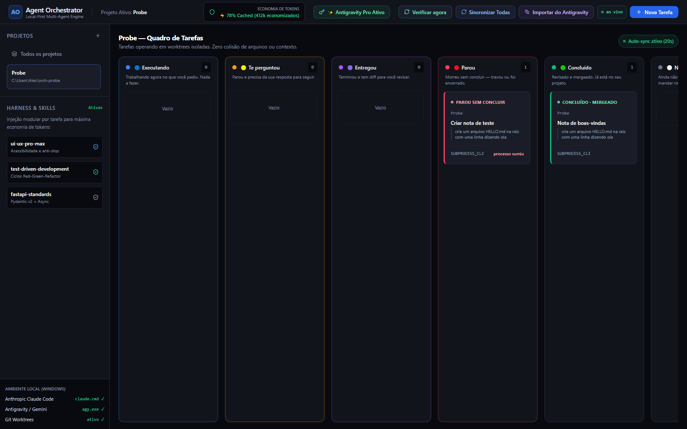
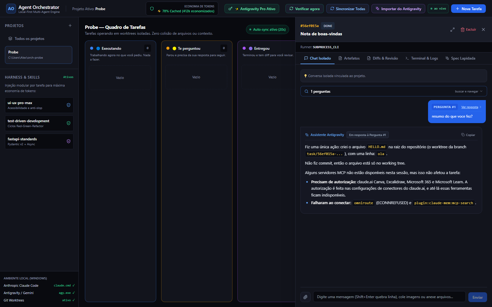

# Agent Orchestrator — Overview e Avaliação Funcional

**Data:** 13 de outubro de 2026
**Branch avaliada:** `traycer/agent-orchestrator-snappy-dolphin` (commit `c0a0fe0`)
**Método:** leitura do código + execução real do sistema (backend em instância isolada na porta
8099 com banco separado, agentes `claude` reais despachados contra um repositório git
descartável, interface dirigida por Playwright).

> **Nota de método.** Nada neste documento foi inferido só da leitura do código. Cada
> funcionalidade foi exercitada de fato e o resultado observado está registrado. Onde não deu
> para verificar, está escrito que não deu. Os defeitos descritos na seção 5 foram reproduzidos
> com evidência coletada do git e do sistema de arquivos, não deduzidos.

---

## 1. O que o produto é

Um orquestrador **local** de agentes de IA para desenvolvimento. O usuário descreve uma tarefa
em linguagem solta, escolhe um motor (Claude Code CLI ou Antigravity/`agy`), e o sistema
despacha o agente **dentro de um git worktree isolado** do projeto alvo. O andamento aparece num
painel kanban, e o usuário revisa o diff antes de aprovar o merge.

É um produto de uso pessoal/local: roda em `127.0.0.1:8000`, dados em SQLite no disco, fortemente
orientado a Windows. Não há autenticação, multiusuário ou deploy remoto — e isso é coerente com
a proposta, não uma omissão.

**Os cinco problemas que ele ataca** (das specs em `docs/specs/`):

| # | Problema | Resposta do produto |
|---|---|---|
| 1 | Chat linear mistura respostas de vários agentes | Canal e histórico por tarefa |
| 2 | Inchaço de contexto | Tarefas atômicas, conhecimento injetado por índice |
| 3 | Dois agentes editando o mesmo arquivo | Um git worktree por tarefa |
| 4 | Prompt bruto rende trabalho ruim | Refinador transforma ideia em spec |
| 5 | Revisão humana é cara | Diff, artefatos e merge com um clique |

**Stack:** FastAPI + SQLAlchemy + SQLite · React 18 + TypeScript + Vite + Tailwind · WebSocket
para tempo real. ~93 arquivos, 186 testes automatizados no backend.

### A decisão de arquitetura que explica o resto

**O agente não é processo filho do servidor.** Ele é lançado desacoplado
(`DETACHED_PROCESS`), e o vínculo com o orquestrador é um arquivo em disco
(`.run/run.json` com PID, instante de início, comando e código de saída) — não um objeto em
memória.

Consequência prática: **reiniciar o servidor não mata trabalho de horas**. Ao subir, o
orquestrador relê os arquivos e reconcilia o estado real de cada agente. Verifiquei isso na
prática: o `run.json` é gravado no disparo e o código de saída aparece lá quando o agente
termina, sem o servidor precisar estar vivo no intervalo.

A segunda decisão relevante: **o estado do card é derivado, não lido do banco.** O card mostra
`card_state`, recalculado a cada resposta a partir do processo real. Sem isso, um agente que
morreu continuaria marcado "Rodando" para sempre. Confirmei a transição completa
`NA_FILA → EXECUTANDO → ENTREGOU` acompanhando `is_alive` e o PID real.

---

## 2. Mapa da interface — o que cada menu faz



### Barra superior

| Elemento | O que faz | Verificado |
|---|---|---|
| **Projeto Ativo** | Indica o projeto cujo quadro está aberto | ✅ |
| **Economia de Tokens — "78% Cached (412k economizados)"** | Nada. **Texto fixo no código** (`App.tsx:267`) | ⚠️ decorativo |
| **Antigravity Pro Ativo** | Abre modal explicando a conexão com a conta Google | ✅ |
| **Verificar agora** | `POST /tasks/refresh-states` — reconsulta o processo real de cada tarefa e corrige status velho | ✅ devolveu `checked: 2` |
| **Sincronizar Todas** | `POST /tasks/sync-all` — puxa novidades das conversas do Antigravity | ✅ |
| **Importar do Antigravity** | Lista conversas do Antigravity da máquina e importa como tarefa | ✅ listou conversa real |
| **ao vivo** | Selo do WebSocket: verde = recebendo eventos em tempo real | ✅ |
| **+ Nova Tarefa** | Abre o modal de criação | ✅ |

### Barra lateral

| Elemento | O que faz | Verificado |
|---|---|---|
| **Projetos / +** | Cadastra projeto apontando para uma pasta git local | ✅ |
| **Todos os projetos** | Quadro consolidado de todas as tarefas | ✅ |
| Clique no projeto | Troca o quadro ativo | ✅ |
| Renomear projeto | `PATCH /projects/{id}` | ✅ |
| Abrir terminal | Abre terminal nativo do Windows na pasta do projeto | não exercitado (abre janela no desktop) |
| **Harness & Skills** (`ui-ux-pro-max`, `test-driven-development`, `fastapi-standards`) | Nada. **HTML fixo** (`Sidebar.tsx:140-160`). Não há injeção de skills por tarefa | ⚠️ decorativo |
| **Ambiente Local (Windows)** com `claude.cmd ✓`, `agy.exe ✓`, `ativo ✓` | Nada. **Os ✓ são fixos** (`Sidebar.tsx:163-178`) — aparecem mesmo sem o CLI instalado | ⚠️ decorativo |

### Quadro kanban — 6 colunas

As colunas não são etapas que o usuário arrasta: são **estados derivados do processo real**.
A redação é deliberadamente em linguagem comum, não em jargão de status.

| Coluna | Significado | Por que existe separada |
|---|---|---|
| **Executando** | Processo vivo de fato agora | — |
| **Te perguntou** | O agente falou por último e espera resposta | Responder custa segundos |
| **Entregou** | Terminou com sucesso, tem diff para revisar | Revisar um diff custa minutos |
| **Parou** | Morreu sem concluir (travou ou foi encerrado) | — |
| **Concluído** | Revisado e mergeado | — |
| **Na fila** | Ainda não foi mandado rodar | — |

Cada card mostra o projeto, o título, a ideia original, o runner e **"quanto mexeu"** (arquivos,
linhas somadas/removidas), apurado do git — fato, não interpretação do agente.

### Painel da tarefa — 5 abas



| Aba | O que faz | Verificado |
|---|---|---|
| **Chat Isolado** | Conversa por tarefa, com anexos (arquivos e imagens coladas). Tem um **navegador de perguntas** indexado e pesquisável, com âncora "Ver resposta" | ✅ pergunta respondida pelo agente, que lembrou o que tinha feito na execução |
| **Artefatos** | Lista documentos que a tarefa criou (não código). Marca `outside_task` quando o agente salvou fora da pasta | ✅ listou `HELLO.md` com preview e tamanho |
| **Diffs & Revisão** | Diff da branch da tarefa contra o ramo base + aprovação do conhecimento proposto pelo agente | ✅ renderizou o diff correto quando havia commit (ver 5.1) |
| **Terminal & Logs** | Saída crua do agente (`.run/output.log`), em tempo real via WebSocket | ✅ |
| **Spec Lapidada** | A spec gerada pelo refinador a partir da ideia bruta | ✅ (ver 5.3) |

Ações do painel: ▶ Rodar, ⏹ Parar, ✅ Aprovar e Mergear, 🗑 Excluir.

---

## 3. Ciclo de vida verificado de ponta a ponta

Executei o ciclo completo com um agente Claude real:

```
POST /tasks                    → DRAFT          (card: Na fila)
POST /{id}/refine              → SPEC_READY     (spec gerada)
POST /{id}/run                 → RUNNING        (card: Executando, is_alive=true)
   ├─ worktree criada em .worktrees/task-<id>, branch task/<id>
   ├─ claude.cmd -p --permission-mode bypassPermissions --session-id <uuid> <prompt>
   └─ .run/run.json com pid + process_started_at + command
agente termina (returncode 0)  → REVIEW_READY   (card: Entregou, 1 arquivo, +1 linha)
GET /{id}/diff, /artifacts     → revisão
POST /{id}/merge               → DONE           (arquivo no repo principal, artefato indexado)
```

**Resultado:** o fluxo principal funciona. O agente foi despachado de verdade, escreveu o
arquivo pedido no worktree isolado, o painel refletiu o estado real do processo, e o merge levou
o arquivo para o repositório principal e registrou o artefato no índice de conhecimento.

Também verifiquei:

- **⏹ Parar**: matou a árvore de processos (`is_alive` passou a `false`) e devolveu a tarefa
  para a fila.
- **🗑 Excluir**: removeu a tarefa.
- **Proteção contra PID reciclado**: o `run.json` guarda PID **e** instante de início. O Windows
  recicla PIDs; sem isso, parar uma tarefa poderia matar um processo alheio do usuário. É um
  cuidado acima da média para um projeto deste porte.
- **Reaproveitamento de worktree**: rodar de novo não recria a pasta. (Correção de um defeito
  anterior que apagava todo o trabalho do agente a cada ▶ Rodar.)

### Testes automatizados

```
186 passed  —  suíte versionada, 100% verde (36 arquivos, backend)
```

Os nomes dos testes descrevem o **sintoma** do defeito que cobrem, em português
(`test_pid_reciclado_nao_e_confundido_com_o_agente`,
`test_nao_inventa_worktree_que_nao_existe`). Quase todo arquivo de teste nasceu de um defeito
real — é uma suíte de regressão honesta, não de fachada.

**Lacuna:** o frontend não tem nenhum teste automatizado.

---

## 4. Pontos fortes

1. **A arquitetura desacoplada é a decisão certa e está bem executada.** O vínculo em arquivo
   resolve de verdade o problema de "reiniciei o servidor e perdi o trabalho".
2. **O estado derivado do processo real** evita a classe inteira de bugs "o painel mente".
3. **Qualidade de comentário acima da média.** Os comentários explicam o *porquê* no formato
   "sintoma → causa → regra" e documentam decisões que parecem estranhas mas são correções de
   bugs reais. É a melhor fonte de contexto do repositório.
4. **Honestidade embutida em decisões de produto.** O "quanto mexeu" sai do git. O conhecimento
   que o agente propõe entra com padrão em **descartar**, teto de 3 linhas, e exige aprovação
   humana. O "Assistente Integrado" foi deliberadamente capado depois de ter declarado
   "[Sucesso] Tarefa pronta!" sem implementar nada.
5. **Vocabulário de interface centrado no custo para o humano** ("Te perguntou" vs. "Entregou"
   separados porque um custa segundos e o outro custa minutos).
6. **Suíte de regressão de 186 testes, verde**, com nomes que descrevem sintomas.

---

## 5. Defeitos e riscos encontrados

Ordenados por gravidade. Todos reproduzidos na execução real.

### 5.1 🔴 CRÍTICO — Merge pode destruir o trabalho do agente e ainda declarar sucesso

**Reproduzido.** O agente criou `HELLO.md` no worktree (confirmado no log e no card: "1 arquivo,
+1 linha"). Cliquei em aprovar. A API respondeu:

```json
{"merged": true, "status": "DONE", "artifacts_indexed": ["HELLO.md"]}
```

A tarefa foi para **Concluído · Mergeado**. Mas `HELLO.md` **não está no repositório principal**:
`git log` continua com um único commit (`init`), e a branch `task/<id>` contém apenas o
`README.md` original. A worktree foi apagada pelo merge. **O arquivo sumiu para sempre.**

**Cadeia causal** (`git_service.py`):

1. `merge_task` chama `commit_pendente` para salvar o que está solto antes de apagar a pasta —
   a intenção está certa e está comentada no código.
2. `commit_pendente` faz `git commit` e captura **qualquer** exceção devolvendo `False`
   (linha 242: `except Exception: return False`).
3. Neste ambiente o `git commit` falha: **não há `user.email` configurado** (confirmei que
   `git config --global user.email` está ausente nesta máquina; um repositório recém-clonado
   ou recém-criado sem identidade local cai exatamente aqui).
4. `merge_task` **ignora o retorno** de `commit_pendente` e segue para o merge.
5. Mergear uma branch sem commits novos é um no-op que **tem sucesso**.
6. A API conclui `merged: true`, marca `DONE` e **remove a worktree** — levando junto o arquivo
   não commitado.

Confirmei a outra ponta da cadeia: com identidade git configurada e um commit presente, o diff
renderiza certo e o merge leva o arquivo para o repositório principal. **O pipeline é sadio; o
que falha é o tratamento de erro.** Uma falha de commit vira uma declaração de sucesso.

Isto viola frontalmente a regra que o próprio projeto escreveu no `CLAUDE.md`: *"Nunca declare
sucesso sem evidência."*

**Correção sugerida:** `commit_pendente` deve propagar a falha; `merge_task` deve abortar se
havia trabalho solto e o commit não aconteceu; e a remoção da worktree só deve ocorrer após
confirmar que o conteúdo está na branch alvo.

### 5.2 🔴 ALTO — O ramo base é suposto como `main` no diff e no merge

**Reproduzido.** Num repositório cujo ramo é `master`, a aba Diffs devolveu:

```
Erro ao obter diff: fatal: ambiguous argument 'main...task/<id>': unknown revision
```

e o merge falhou com **`409 Conflito de merge detectado`** — mensagem enganosa: não havia
conflito algum, o ramo `main` simplesmente não existe. Ao corrigir o ramo base do projeto para
`master`, diff e merge passaram a funcionar imediatamente.

**Causa:** `get_diff` e `merge_task` usam `task.project.default_branch`, que nasce fixo como
`"main"` na criação do projeto e **não tem campo na interface para ser alterado**. O projeto já
tem a função que resolve isso corretamente — `git_service.branch_base`, que descobre o ramo
(`origin/HEAD` → main/master/trunk/develop → ramo atual) — e ela **é** usada na criação da
worktree (por isso o disparo funciona), mas **não** no diff nem no merge.

O `CLAUDE.md` também já alerta: *"Nunca suponha que o ramo base é `main`. Use
`git_service.branch_base`, que descobre."* A correção é de uma linha em cada ponto.

### 5.3 🟡 MÉDIO — "Entregou" não significa que algo foi entregue

**Reproduzido.** Despachei uma tarefa; o agente achou o prompt confuso e **respondeu com uma
pergunta** em vez de trabalhar ("Talvez o texto tenha sido cortado ao colar. O que você quer que
eu faça?"). Saiu com código 0.

O orquestrador marcou a tarefa como **Entregou** — "Terminou e tem diff para você revisar" — com
`changed_files: 0`. Não havia diff nenhum.

A regra hoje é `returncode == 0 ⇒ ENTREGOU`, o que confunde "o agente saiu limpo" com "o
trabalho foi feito". Como o produto já apura "quanto mexeu" pelo git, a informação para
distinguir os dois casos **já está disponível**: uma entrega com zero arquivos alterados
deveria cair em "Te perguntou" ou num estado próprio, não em "Entregou".

### 5.4 🟡 MÉDIO — O refinador de prompt inventa conteúdo

O refinador é **heurístico, sem LLM**. Para a ideia "crie um arquivo HELLO.md na raiz com uma
linha dizendo ola", ele gerou:

```markdown
## Arquivos Alvo
- `app/main.py`                      ← arquivo que não existe neste projeto

## Passos de Execução
1. Analisar requisitos e contratos em app/main.py
3. Executar suíte de testes unitários para validar a alteração

## Critérios de Aceite
- [ ] Cobertura de testes automatizados passando 100%     ← irrelevante para a tarefa
```

Essa spec vai inteira para o prompt do agente. Ou seja, o passo que existe para *melhorar* a
instrução acrescenta ruído fabricado e manda o agente mexer num arquivo inventado. É a
funcionalidade mais fraca do conjunto, e a que mais destoa da qualidade do resto.

### 5.5 🟡 MÉDIO — Dois caminhos executam o prompt como comando de shell

`resolve_cli_command` escolhe o CLI procurando "claude" ou "agy" numa string de configuração.
Quando não acha nenhum, cai em `["cmd", "/c", prompt]` — isto é, **entrega o texto da tarefa ao
interpretador de comandos do Windows**. Reproduzido:

```
'##' não é reconhecido como um comando interno ou externo
```

A tarefa foi para **Parou**, sem nenhuma pista de que o agente jamais foi chamado. Dois caminhos
chegam lá:

1. **Tarefa criada pela API sem `runner_config.cli`** (o padrão do próprio schema). A interface
   sempre manda `cli`, então o uso normal escapa — mas qualquer automação ou integração cai.
2. **A opção "Comando Customizado" do menu de motor**, que manda `cli: "custom"` sem nenhum
   campo para informar o comando. Essa opção do menu está, na prática, quebrada.

O fallback deveria falhar explicitamente ("nenhum CLI de agente reconhecido") em vez de executar
o prompt.

### 5.6 🟡 MÉDIO — Segurança: o agente tem a máquina inteira

`CLAUDE_PERMISSION_MODE` é **`bypassPermissions`** por padrão, e o `agy` é chamado com
`--dangerously-skip-permissions`. O worktree isola **arquivos entre tarefas**; não é sandbox de
segurança. Na prática: **o agente executa qualquer comando na máquina do usuário**, com os
privilégios do usuário.

O código documenta essa escolha com honestidade e explica o motivo (sem autonomia, `claude -p`
trava na primeira permissão e não tem como avisar). Para uso pessoal local é uma troca
defensável. Precisa estar explícito para qualquer decisão de distribuir isto para terceiros.

Relacionado: CORS com `allow_origins=["*"]` junto de `allow_credentials=True`, mitigado por
ouvir apenas em `127.0.0.1`. E o renderizador de markdown injeta HTML vindo do agente **sem
sanitização**.

### 5.7 🟢 BAIXO — Elementos decorativos que parecem telemetria

Três blocos da interface aparentam informação dinâmica e são texto fixo:

- **"⚡ 78% Cached (412k economizados)"** — número inventado, fixo no código.
- **"Harness & Skills — Ativas"** com três skills listadas — não existe injeção de skills.
- **"Ambiente Local (Windows)"** com `claude.cmd ✓`, `agy.exe ✓`, `ativo ✓` — os ✓ são fixos e
  aparecem mesmo sem os CLIs instalados. (Ironicamente, o backend **tem** detecção real de CLI
  em `/api/settings`, que a interface não usa aqui.)

Não quebram nada, mas prometem recursos inexistentes e corroem a confiança no que o painel
informa — justamente a virtude central do produto. O caso do ✓ é o mais sério dos três, porque
é um diagnóstico falso: ele diz que o ambiente está pronto sem ter verificado.

### 5.8 🟢 BAIXO — Pendências de ciclo de vida

| Item | Efeito |
|---|---|
| Testes TDD não commitados (`test_artefato_de_fora_abre.py`) | 4 testes vermelhos no diretório, exigindo um contrato (`rel_path`) que o código resolveu de outro jeito (prefixo no `name`). Além disso, poluem o banco compartilhado e derrubam um 5º teste por tabela — a suíte versionada sozinha passa 186/186 |
| `DELETE /tasks/{id}` não chama `stop_detached` | Um agente desacoplado pode sobreviver à exclusão da tarefa |
| `merge` não apaga a branch `task/<id>` | Branches acumulam no repositório do usuário |
| `merge_task` faz `git checkout` no repositório principal | **Muda o ramo ativo do usuário** sem avisar |
| `launch_detached` abre o log em modo `"w"` | O log da execução anterior é sobrescrito |
| `QUEUED` e `MAX_CONCURRENT_TASKS` | Existem no código, **não há fila implementada** — nada limita quantos agentes rodam ao mesmo tempo |
| Dois estilos de isolamento nos testes | Parte da suíte escreve no `orchestrator.db` de desenvolvimento |

---

## 6. Avaliação

| Dimensão | Nota | Comentário |
|---|---|---|
| Arquitetura | **Forte** | O desacoplamento e o estado derivado são decisões acertadas e bem executadas |
| Fluxo principal | **Funciona** | Verificado de ponta a ponta com agente real |
| Robustez no caminho de erro | **Fraca** | 5.1 e 5.2 estão exatamente aqui: o sistema supõe sucesso onde deveria verificar |
| Qualidade de código e comentário | **Forte** | Comentários explicam o porquê; decisões documentadas |
| Testes | **Bom no backend, ausente no frontend** | 186 verdes, nomeados por sintoma |
| Honestidade do produto | **Contraditória** | Decisões de produto exemplares (5.1 do CLAUDE.md, conhecimento com aprovação) convivendo com indicadores fixos de fachada (5.7) e com um merge que declara sucesso sem evidência (5.1) |
| Segurança | **Aceitável só para uso local** | Autonomia total do agente por padrão |

### Leitura geral

O projeto tem **boa engenharia no caminho feliz e tratamento de erro frágil**. O padrão que se
repete nos dois defeitos graves é o mesmo: uma operação de git falha, a exceção é engolida por
um `except` genérico, e o sistema segue adiante relatando sucesso. Não é falta de cuidado com o
desenho — o desenho é bom, e o próprio repositório escreveu a regra certa ("nunca declare
sucesso sem evidência") antes de violá-la na implementação do merge.

A diferença entre este projeto e um protótipo é real: a proteção contra PID reciclado, o
reaproveitamento de worktree, o conhecimento com aprovação humana e os 186 testes nomeados por
sintoma são trabalho de quem já apanhou de bugs concretos e os cobriu. O que falta é fechar a
mesma régua nos pontos onde o git pode falhar.

### Prioridade recomendada

1. **5.1** — merge não pode apagar trabalho não commitado nem declarar sucesso sem confirmar.
   É perda de dados silenciosa; é o item que precisa ser corrigido antes de qualquer outro.
2. **5.2** — usar `branch_base` no diff e no merge (correção de uma linha em cada).
3. **5.5** — fazer o fallback de CLI falhar explicitamente, em vez de executar o prompt no shell.
4. **5.3** — "Entregou" com zero arquivos alterados não é entrega.
5. **5.7** — remover os indicadores fixos ou ligá-los aos dados reais que o backend já expõe.
6. **5.4** — o refinador: ou vira LLM de verdade, ou deixa de inventar arquivos e critérios.

---

## 7. Como reproduzir

```bash
start.bat                                            # sobe tudo em http://127.0.0.1:8000
start.bat rebuild                                    # força recompilar o frontend
backend/venv/Scripts/python.exe -m pytest tests -q   # testes (a partir de backend/)
```

Pré-requisitos: git com suporte a worktree; `claude` e/ou `agy` no PATH; Node/npm apenas para
recompilar o painel.

Para reproduzir 5.1 e 5.2: crie um repositório git novo cujo ramo seja `master`, **sem**
`user.email` configurado, cadastre-o como projeto, rode uma tarefa que crie um arquivo e
aprove o merge. O arquivo não chegará ao repositório principal e a tarefa aparecerá como
Concluído.
