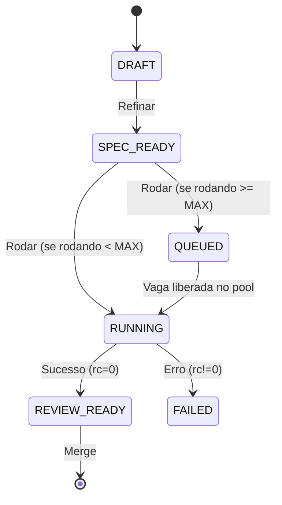
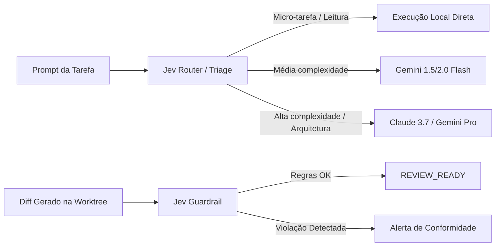

# Design: Otimização de Tokens, Continuidade de Sessão Antigravity e Multi-Agentes com Jev

**Data**: 2026-10-13  
**Status**: Proposto (Aguardando Aprovação)  
**Autor**: Engenheiro de Software Sênior do Agent Orchestrator  
**Branch**: `feature/multi-agent-token-optimization`

---

## 1. Visão Geral & Motivação

O **Agent Orchestrator** hoje gerencia com sucesso tarefas em git worktrees isoladas e suporta os motores Claude e Antigravity (`agy`). No entanto, ao escalar para fluxos multi-agente e múltiplos disparos em projetos complexos (como o SIGMA), surgem três gargalos principais:

1. **Perda de Continuidade de Sessão no Antigravity**: Enquanto o Claude pré-gera `claude_session_id` e reaproveita o contexto no chat, o `agy` tenta capturar `conversationId` via JSON do legado `agentapi`. Como o `agy -p` responde em Markdown no stdout, o ID se perde e novas interações no chat iniciam agentes cegos.
2. **Ausência de Controle de Fila (`QUEUED`)**: Disparar múltiplas tarefas concorrentes executa todas simultaneamente sem respeitar `MAX_CONCURRENT_TASKS`. Isso satura CPU no Windows e consome rate limits de API.
3. **Imposto de Tokens em Decisões Simples**: Todo roteamento, verificação de conformidade e triagem de tarefas depende de LLMs generativos pesados gerando centenas de tokens de texto para decisões binárias ou categóricas.

A proposta organiza as melhorias em três fases, da **mais simples para a mais complexa**:

---

## 2. Fase 1: Continuidade do Antigravity & Skills com Progressive Disclosure

### 2.1 Continuidade de Sessão
- **Problema**: `api/tasks.py` gera `claude_session_id = str(uuid.uuid4())`, mas não faz o mesmo para `antigravity_conversation_id`.
- **Solução**:
  - Pré-gerar `antigravity_conversation_id = str(uuid.uuid4())` no `api/tasks.py:run_task` antes do lançamento quando o CLI for `agy` ou Antigravity.
  - No `runner_service.resolve_cli_command`, garantir que `agy -p --dangerously-skip-permissions --conversation <id>` receba sempre esse ID.
  - No chat (`assistant_service.py`), reutilizar `--conversation <id>` nas chamadas subsequentes.

### 2.2 Descoberta de Skills & Progressive Disclosure
- **Problema**: Injetar prompts gigantescos com todas as regras do projeto estoura a janela de contexto.
- **Solução**:
  - Implementar `skills_service.py` para descobrir skills locais (`.agents/skills/` e `~/.gemini/config/skills/`).
  - No prompt inicial do agente, injetar apenas o sumário (nome + descrição do frontmatter YAML). O corpo completo só é lido pelo agente via ferramenta de leitura sob demanda.
  - Oferecer na interface da tarefa a seleção de perfis de skills (ex: `Superpowers`, `Frontend-UI`, `DB-SQLServer`).

---

## 3. Fase 2: Fila de Tarefas Concorrentes (`QUEUED` + `MAX_CONCURRENT_TASKS`)

### 3.1 Máquina de Estados da Fila

### 3.2 Arquitetura da Fila
- Criar `app/services/queue_service.py` singleton:
  - Monitora tarefas com status `TaskStatus.RUNNING` ativas.
  - Se `contagem_ativas >= settings.MAX_CONCURRENT_TASKS`: define status da nova tarefa como `TaskStatus.QUEUED`.
  - Ao término de uma tarefa (`_run_task_background` ou `stop_task`), aciona `queue_service.despachar_proxima()`.
  - Notifica o painel via WebSocket (`ws_manager.broadcast_dashboard`) na transição de `QUEUED` para `RUNNING`.

---

## 4. Fase 3: Roteamento Estruturado, Guardrails e Camada JEV (System 1)

### 4.1 O que é o Jev e seu papel na economia de tokens
O **Jev** (TypeSafe AI) é um modelo de decisão não-autorregressivo (System 1). Diferente de LLMs que geram texto token por token, o Jev recebe um contexto/estado e retorna classificações categóricas e probabilidades com **zero output token overhead** e latência sub-segundo.

### 4.2 Componentes da Camada JEV:
1. **`jev_service.py`**:
   - Abstração de cliente e fallback heurístico caso a API do Jev não esteja configurada localmente.
   - **Triagem (Route-First)**:
     - Classifica intenção: `tipo` (bugfix, feature, doc, refactor), `complexidade` (1 a 5), `motor sugerido` (flash vs pro).
     - Economia estimada: 2.000 a 5.000 tokens por tarefa ao evitar LLM pesado para tarefas triviais.
   - **Guardrail de Conformidade (Verify-After)**:
     - Avalia diffs contra regras críticas (ex: no SIGMA: proibição de `prisma migrate dev`, exigência de `@db.NVarChar(Max)`).
     - Retorna `aprovado: bool`, `score: float`, `violacoes: list[str]` sem chamar LLM para auditoria textual.

---

## 5. Estratégia de Implementação e TDD

Seguiremos rigorosamente o ciclo RED-GREEN-REFACTOR para cada fase:
1. **Fase 1**:
   - `test_antigravity_pregenerated_conversation_id.py`
   - `test_skills_progressive_disclosure.py`
2. **Fase 2**:
   - `test_queue_service_concurrency_limit.py`
   - `test_queue_dispatch_on_completion.py`
3. **Fase 3**:
   - `test_jev_routing_and_guardrails.py`

---

## 6. Critérios de Aceite
- [ ] Pré-geração de ID do Antigravity ativa e chat mantendo conversa.
- [ ] Skills com carregamento progressivo funcionando sem poluir prompt inicial.
- [ ] Tarefas excedendo `MAX_CONCURRENT_TASKS` entram em `QUEUED` e avançam ordenadamente.
- [ ] Camada de triagem e verificação estruturada funcional com fallback local.
- [ ] Toda a suíte de testes passando.
